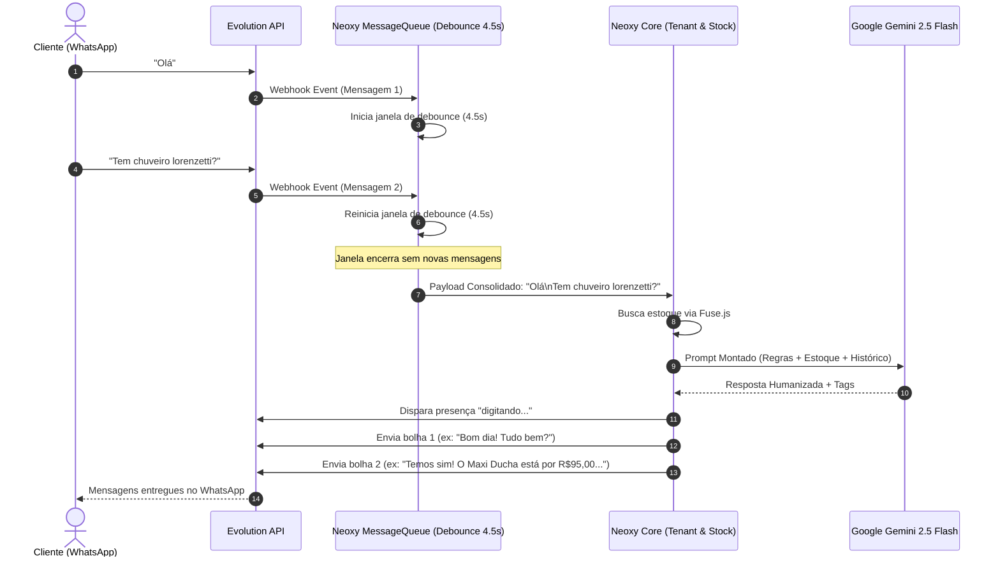

# ⚡ Pipeline de Mensageria — Neoxy.ai

O pipeline foi desenhado para resolver dois problemas clássicos de bots de WhatsApp:
1. **Rajadas de Mensagens Rápidas**: Clientes mandam "Oi" -> "tudo bem?" -> "tem parafuso 8mm?".
2. **Duplicação de Respostas e Custo Excessivo**: Se cada mensagem disparar um LLM, o bot enviará 3 respostas truncadas e gastará 3x mais tokens.

### Componentes Chave:
- **`messageQueueService.js`**: Gerencia o timer por chave `tenantId:customerPhone`.
- **`processingLocks`**: Trava atômica que impede que uma nova mensagem seja processada enquanto o Gemini ainda está gerando a anterior.
- **Divisão em Bolhas**: Quebra as respostas da IA por parágrafos duplos (`\n\n`) e envia com intervalo de ~600ms, simulando a digitação de uma pessoa real.
